# Graphia graph topology (generated)

<!-- Generated by `make graph-diagram` from the compiled graph. Do not edit by hand. -->

This is the compiled LangGraph `StateGraph`, rendered by LangGraph itself from the
same `_assemble_graph` that local and hosted modes use, so it cannot drift from
the code. Solid arrows are plain edges; dashed arrows are conditional edges.
For what each node does, the state it writes and the LLMs it calls, see the
hand-maintained [`langgraph-topology.mermaid`](langgraph-topology.mermaid).
Regenerate with `make graph-diagram`.

```mermaid
%%{init: {'theme':'base','flowchart':{'curve':'linear'},'themeCSS':'span,p,text,tspan{color:#000000!important;fill:#000000!important;}.nodeLabel,.nodeLabel span,.nodeLabel p,.edgeLabel,.edgeLabel span,.edgeLabel p,.cluster-label,.cluster-label span,.cluster-label p,.label,.label span,.label p{color:#000000!important;fill:#000000!important;}','themeVariables':{'background':'#ffffff','fontFamily':'ui-sans-serif, system-ui, sans-serif','fontSize':'14px','textColor':'#000000','primaryTextColor':'#000000','secondaryTextColor':'#000000','tertiaryTextColor':'#000000','nodeTextColor':'#000000','titleColor':'#000000','lineColor':'#000000','edgeLabelBackground':'#ffffff','labelBackground':'#ffffff','clusterBkg':'#adb5bd','clusterBorder':'#343a40'}}}%%
flowchart TB
    classDef node fill:#d3f9d8,stroke:#000000,stroke-width:2px,color:#000000
    classDef first fill:#e9ecef,stroke:#000000,stroke-width:2px,color:#000000
    classDef last fill:#e9ecef,stroke:#000000,stroke-width:2px,color:#000000
    subgraph GRAPH ["StateGraph(GameState), as compiled"]
        direction TB
        __start__([<p>__start__</p>]):::first
        collect_name(collect_name):::node
        generate_roster(generate_roster):::node
        assign_roles(assign_roles):::node
        generate_personas(generate_personas):::node
        introduce_roster(introduce_roster):::node
        reveal_role(reveal_role):::node
        first_night_mafia_intros(first_night_mafia_intros):::node
        night_open(night_open):::node
        mafia_round_start(mafia_round_start):::node
        mafia_point(mafia_point):::node
        resolve_night_kill(resolve_night_kill):::node
        night_close(night_close):::node
        day_open(day_open):::node
        day_turn(day_turn):::node
        day_round_reflect(day_round_reflect):::node
        vote_prompt(vote_prompt):::node
        collect_votes(collect_votes):::node
        resolve_vote(resolve_vote):::node
        day_close(day_close):::node
        day_diary(day_diary):::node
        check_win_night(check_win_night):::node
        check_win_day(check_win_day):::node
        end_screen(end_screen):::node
        moderator_story(moderator_story):::node
        __end__([<p>__end__</p>]):::last
        __start__ --> collect_name;
        assign_roles --> generate_personas;
        check_win_day -.-> day_close;
        check_win_day -.-> day_turn;
        check_win_day -.-> end_screen;
        check_win_night -.-> end_screen;
        check_win_night -.-> night_close;
        collect_name --> generate_roster;
        collect_votes -.-> resolve_vote;
        day_close --> day_diary;
        day_diary --> night_open;
        day_open --> day_turn;
        day_round_reflect --> day_turn;
        day_turn -.-> day_close;
        day_turn -.-> day_round_reflect;
        day_turn -.-> vote_prompt;
        end_screen --> moderator_story;
        first_night_mafia_intros --> night_open;
        generate_personas --> introduce_roster;
        generate_roster --> assign_roles;
        introduce_roster --> reveal_role;
        mafia_point -.-> mafia_round_start;
        mafia_point -.-> resolve_night_kill;
        mafia_round_start --> mafia_point;
        night_close --> day_open;
        night_open -.-> end_screen;
        night_open -.-> mafia_round_start;
        resolve_night_kill --> check_win_night;
        resolve_vote --> check_win_day;
        reveal_role --> first_night_mafia_intros;
        vote_prompt --> collect_votes;
        moderator_story --> __end__;
        collect_votes -.-> collect_votes;
        day_turn -.-> day_turn;
        mafia_point -.-> mafia_point;
    end
    linkStyle default stroke:#000000,stroke-width:2px
```

